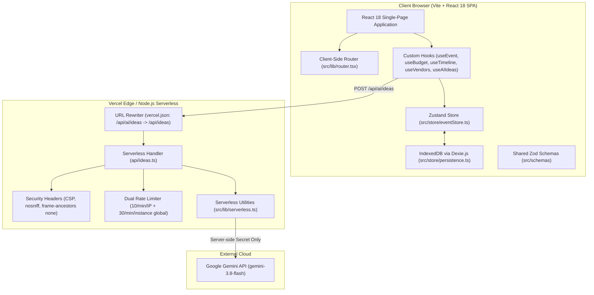

# Celebration & Event Planner

A full-stack, GenAI-powered celebration and event planning application that helps users organize **weddings**, **birthdays**, and **community events** with adaptive budgets, backward-planned timelines, vendor checklists, and personalized AI ideas.

- **Live Deployment**: [https://celebration-planner-promptwars.vercel.app](https://celebration-planner-promptwars.vercel.app)
- **Repository**: [https://github.com/bright-phoenix-dev/celebration-planner](https://github.com/bright-phoenix-dev/celebration-planner)

---

## Architecture Overview



### Architecture Highlights

- **Frontend Framework**: Vite + React 18 SPA with lightweight HTML5 history routing (`src/lib/router.tsx`).
- **Styling**: Tailwind CSS + accessible Radix UI primitives with full dark mode and reduced-motion support.
- **Client Persistence**: 100% offline-first local retention using IndexedDB via Dexie.js (`src/store/persistence.ts`). Data persists seamlessly across page refreshes, tab closures, and multiple events.
- **Serverless AI Gateway**: Single authoritative serverless endpoint (`api/ideas.ts`), exposed via `/api/ai/ideas`, holding `GEMINI_API_KEY` exclusively on the server.
- **AI Model**: Google Gemini (`gemini-3.8-flash` by default, configurable via `GEMINI_MODEL`).
- **Security & Rate Limiting**: Dual sliding-window rate limiting (10 req/min per IP and 30 req/min global instance cap), response security headers (`X-Content-Type-Options: nosniff`, `Cache-Control: no-store`), and strict site CSP headers in `vercel.json`.
- **Error Handling**: Graceful translation of Google API errors (429 rate limit with `Retry-After: 60`, 404 model unavailable, 401 invalid key, 502 parse error, 503 high demand) with automatic API key redaction in server logs.

---

## Requirements Traceability

| Requirement                   | Description                                                                                                                                                                                         | Implementation File(s)                                                                                                                             |
| :---------------------------- | :-------------------------------------------------------------------------------------------------------------------------------------------------------------------------------------------------- | :------------------------------------------------------------------------------------------------------------------------------------------------- |
| **Budget Allocation**         | Total budget & guest count input with adaptive category allocations (venue, catering, decor, entertainment, attire, photography, misc). Planned vs. actual spend tracking and over-budget alerts.   | `src/lib/budget.ts`, `src/schemas/budget.ts`, `src/hooks/useBudget.ts`, `src/components/budget/BudgetTab.tsx`                                      |
| **Backward-Planned Timeline** | Milestone timeline backward-planned from event date (12 months, 6 months, 3 months, 1 month, 1 week, day-of) with editable tasks, due dates, and completion toggles.                                | `src/lib/timeline.ts`, `src/schemas/timeline.ts`, `src/hooks/useTimeline.ts`, `src/components/timeline/TimelineTab.tsx`                            |
| **Vendor Checklist**          | Per-event checklist categorized by event type with statuses (`to-contact`, `contacted`, `quoted`, `booked`, `paid`), quoted prices, contact info, and notes.                                        | `src/lib/vendors.ts`, `src/schemas/vendor.ts`, `src/hooks/useVendors.ts`, `src/components/vendors/VendorsTab.tsx`                                  |
| **Personalized AI Ideas**     | GenAI assistant taking event preferences (theme, culture/traditions, dietary needs, venue type, vibe, budget) and generating structured ideas for themes, decor, menu, activities, and invitations. | `src/services/ai.ts`, `api/ideas.ts`, `src/lib/serverless.ts`, `src/schemas/ai.ts`, `src/hooks/useAIIdeas.ts`, `src/components/ideas/IdeasTab.tsx` |
| **Event Typologies**          | Full support and customized presets for weddings, birthdays, and community events.                                                                                                                  | `src/schemas/event.ts`, `src/lib/constants.ts`, `src/components/onboarding/EventTypeSelector.tsx`                                                  |
| **Local Persistence**         | Zero-leak local data persistence in IndexedDB using Dexie.                                                                                                                                          | `src/store/persistence.ts`, `src/store/eventStore.ts`                                                                                              |
| **Security & Rate Limiting**  | Serverless Gemini API key isolation, dual rate limiting, response security headers, and site CSP in `vercel.json`.                                                                                  | `api/ideas.ts`, `src/lib/serverless.ts`, `vercel.json`, `.env.example`                                                                             |
| **Export / Print**            | Dedicated print-friendly CSS and export triggers for physical printouts and PDF archiving.                                                                                                          | `src/lib/export.ts`, `src/components/dashboard/ExportButton.tsx`, `src/components/dashboard/PrintView.tsx`, `src/styles/globals.css`               |

---

## Environment Variables

Copy `.env.example` to `.env`:

```bash
cp .env.example .env
```

| Variable                | Required           | Default            | Description                                                                        |
| :---------------------- | :----------------- | :----------------- | :--------------------------------------------------------------------------------- |
| `GEMINI_API_KEY`        | Yes (for AI Ideas) | None               | Google Gemini API key from [Google AI Studio](https://aistudio.google.com/apikey). |
| `GEMINI_MODEL`          | No                 | `gemini-3.8-flash` | Gemini model name for generation (defaults to `gemini-3.8-flash`).                 |
| `RATE_LIMIT_MAX`        | No                 | `10`               | Maximum requests per minute per IP on `/api/ai/ideas`.                             |
| `RATE_LIMIT_GLOBAL_MAX` | No                 | `30`               | Maximum requests per minute per serverless execution instance.                     |

---

## Setup & Running

### 1. Install Dependencies

```bash
npm install
```

### 2. Run Development Server

```bash
npm run dev
```

Open [http://localhost:3000](http://localhost:3000) in your browser.

### 3. Build for Production

```bash
npm run build
npm run preview
```

---

## Verification & Test Suite

The test suite consists of **18 test files** and **121 passing tests** with **95.4% code coverage**:

| Test Suite                            | File                                                 | Tests           |
| :------------------------------------ | :--------------------------------------------------- | :-------------- |
| **Budget Logic**                      | `src/__tests__/unit/budget.test.ts`                  | 10              |
| **Timeline Logic**                    | `src/__tests__/unit/timeline.test.ts`                | 7               |
| **AI Generation Service**             | `src/__tests__/unit/ai-service.test.ts`              | 9               |
| **Zod Schemas**                       | `src/__tests__/unit/schemas.test.ts`                 | 12              |
| **Serverless Utilities**              | `src/__tests__/unit/serverless-utils.test.ts`        | 19              |
| **Serverless Integration**            | `src/__tests__/integration/serverless-ideas.test.ts` | 16              |
| **Budget Component**                  | `src/__tests__/components/BudgetOverview.test.tsx`   | 3               |
| **Ideas Panel Component**             | `src/__tests__/components/IdeasPanel.test.tsx`       | 2               |
| **Ideas Tab (A11y & Error Recovery)** | `src/__tests__/components/IdeasTab.test.tsx`         | 3               |
| **Dashboard Views**                   | `src/__tests__/components/DashboardView.test.tsx`    | 4               |
| **Vendor Logic**                      | `src/__tests__/unit/vendors.test.ts`                 | 5               |
| **SPA Router & Link**                 | `src/__tests__/unit/router.test.tsx`                 | 5               |
| **Timeline Component**                | `src/__tests__/components/TimelineView.test.tsx`     | 2               |
| **Layout & Theme Switch**             | `src/__tests__/components/Layout.test.tsx`           | 3               |
| **Onboarding Wizard**                 | `src/__tests__/components/OnboardingWizard.test.tsx` | 2               |
| **Axe-Core Audits (Light & Dark)**    | `src/__tests__/unit/a11y.test.tsx`                   | 14              |
| **Vendor Checklist Component**        | `src/__tests__/components/VendorChecklist.test.tsx`  | 3               |
| **Export / Print Utilities**          | `src/__tests__/unit/export.test.ts`                  | 2               |
| **TOTAL**                             | **18 test files**                                    | **121 passing** |

### Running the Checks

```bash
# 1. Type check (0 errors)
npm run typecheck

# 2. Lint check (0 warnings, 0 errors)
npm run lint

# 3. Format check (Prettier)
npm run format:check

# 4. Vitest Unit & Integration suite with Coverage (95.4% coverage)
npm run test:coverage

# 5. Production Build
npm run build
```
