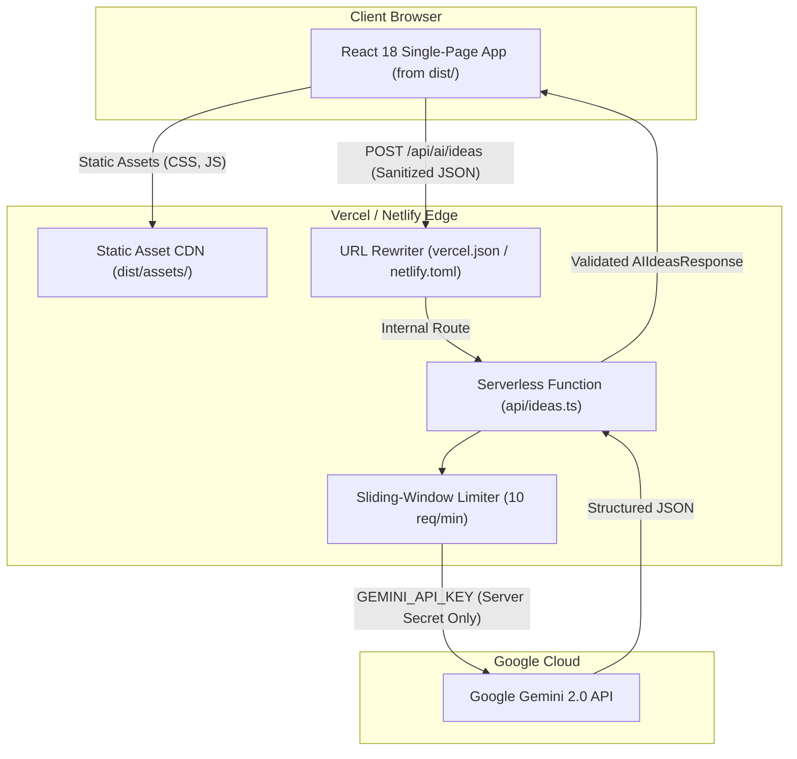

# Deployment Guide — Celebration & Event Planner

This guide provides tested, step-by-step instructions for deploying Celebration & Event Planner to **Vercel** and **Netlify**, ensuring that the `GEMINI_API_KEY` remains strictly server-side and is never exposed in client bundles.

---

## Architecture Diagram (Production Deployment)



---

## 1. Deploying to Vercel (Recommended)

### Option A: One-Click Git Integration

1. Push your repository to GitHub, GitLab, or Bitbucket.
2. Log into the [Vercel Dashboard](https://vercel.com/dashboard) and click **"Add New..." > "Project"**.
3. Import your repository.
4. Under **"Build and Output Settings"**:
   - **Framework Preset**: Vite
   - **Root Directory**: `celebration-planner` (or `./` if deployed from the project root)
   - **Build Command**: `npm run build`
   - **Output Directory**: `dist`
5. Under **"Environment Variables"**, add:
   - `GEMINI_API_KEY`: Your Google Gemini API key from [Google AI Studio](https://aistudio.google.com/apikey).
   - `GEMINI_MODEL`: `gemini-3.8-flash` (Optional; defaults to `gemini-3.8-flash`).
   - `RATE_LIMIT_MAX`: `10` (Optional; defaults to 10 requests per minute).
   > **Note**: Do **NOT** prefix this variable with `NEXT_PUBLIC_` or `VITE_`. Leaving it un-prefixed guarantees it will never be bundled into client-facing JavaScript.
6. Click **Deploy**. Vercel will build the frontend into `dist/` and automatically bind `api/ideas.ts` as a serverless function according to `vercel.json`.

### Option B: Vercel CLI

```bash
# 1. Install Vercel CLI globally
npm install -g vercel

# 2. Login to your Vercel account
vercel login

# 3. Deploy to production
cd celebration-planner
vercel --prod
```

During the prompt:

- Link to existing project? **No**
- What's your project's name? **celebration-planner**
- In which directory is your code located? **./**
- Want to modify settings? **No** (Vercel automatically detects `vercel.json` with framework: "vite", output: "dist")

Set your server-side secret:

```bash
vercel env add GEMINI_API_KEY production
```

---

## 2. Deploying to Netlify

Netlify supports static assets with serverless functions natively.

### Steps:

1. Push your project to your Git provider.
2. In the [Netlify App Console](https://app.netlify.com/), click **"Add new site" > "Import an existing project"**.
3. Configure build settings (automatically detected from `netlify.toml`):
   - **Base directory**: `celebration-planner`
   - **Build command**: `npm run build`
   - **Publish directory**: `dist`
   - **Functions directory**: `api`
4. Go to **Site configuration > Environment variables**, click **"Add a variable"**:
   - Key: `GEMINI_API_KEY`, Value: `your_gemini_api_key_here`
   - Key: `GEMINI_MODEL`, Value: `gemini-3.8-flash` (Optional; defaults to `gemini-3.8-flash`)
   - Scopes: **Functions / Builds** only (do not enable "Runtime (Browser)").
5. Click **Deploy Site**.

---

## 3. Post-Deployment Verification Checklist

Once deployed, verify production security and function:

- [ ] **Check Client Bundle**: Inspect `Network` tab in Chrome DevTools on the live URL. Search all `.js` assets for your Gemini API key string or `AIza` pattern to confirm zero leakage.
- [ ] **Test AI Generation**: Navigate to `/event/<id>`, open the **Ideas** tab, and submit a test prompt. Verify structured cards render without console errors.
- [ ] **Test Rate Limiter**: Rapidly submit requests to `/api/ai/ideas` 11 times from the same browser. Confirm request #11 returns HTTP 429 with `"Too many requests. Please wait a minute before trying again."`.
- [ ] **Test Offline Persistence**: Disconnect internet or turn on Airplane Mode, refresh the page, and confirm event data persists from IndexedDB.
