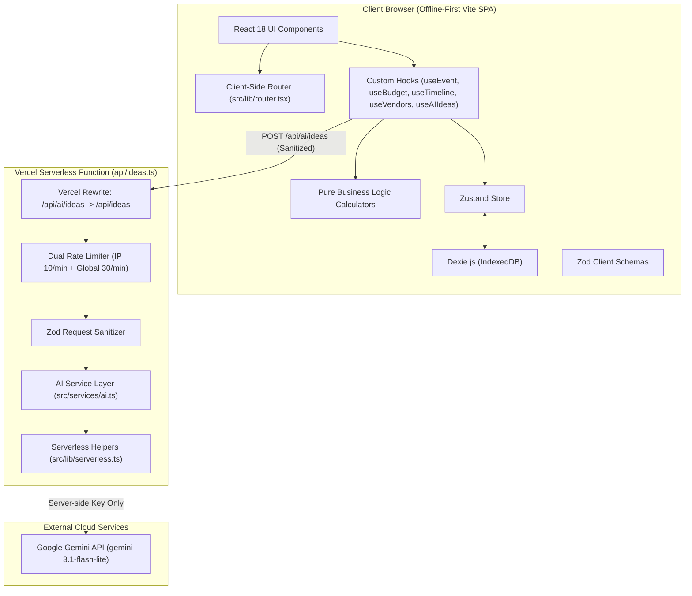

# Celebration & Event Planner

> **A GenAI-powered planning command center for weddings, birthdays, and community events with adaptive budgets, backward-planned timelines, vendor checklists, and hyper-personalized ideas.**

[](https://www.typescriptlang.org/)
[](https://vitest.dev/)
[](https://vitest.dev/)
[-brightgreen>)](https://github.com/dequelabs/axe-core)
[](https://www.w3.org/WAI/WCAG21/AA/)

- **Live URL**: [https://celebration-planner-promptwars.vercel.app](https://celebration-planner-promptwars.vercel.app)
- **Repository**: [https://github.com/bright-phoenix-dev/celebration_planner-PROMPTWARS](https://github.com/bright-phoenix-dev/celebration_planner-PROMPTWARS)

---

## The Problem

Planning a milestone celebration is an exercise in stress. Organizers typically juggle 4–6 disconnected tools: spreadsheets for budgets that drift out of sync, generic checklists that don't account for event-specific timelines, fragmented vendor notes on napkins or WhatsApp, and superficial Pinterest boards that offer zero practical coordination. The result is budget overruns, missed deadlines, and severe host anxiety.

## The Solution

**Celebration & Event Planner** consolidates the entire event lifecycle into a single, cohesive, GenAI-augmented workspace tailored to three core event types: **Weddings**, **Birthdays**, and **Community Events**.

From an initial guest count and target budget, the application:

1. Calculates adaptive category-wise budget allocations with planned vs. actual spend tracking and WCAG-compliant overage warnings.
2. Auto-generates a backward-planned milestone timeline from the event date down to the day-of.
3. Builds an event-tailored vendor checklist tracking 5 status stages, quotes, and notes.
4. Generates hyper-personalized, culturally aware ideas across themes, decor, curated menus, activities, and invitations using Google Gemini (`gemini-3.1-flash-lite`).

---

## Key Features

- **Adaptive Budget Allocator**: Dynamic percentage splits based on event typology (e.g. Wedding attire & photography vs. Community permits & logistics). Tracks planned vs. actual spend with warning badges and icons.
- **Backward-Planned Milestone Timeline**: Calculates exact due dates relative to event day across 6 milestone phases (12 Months, 6 Months, 3 Months, 1 Month, 1 Week, Day-Of). Tasks are fully editable with completion toggles and progress bars.
- **Categorized Vendor Checklist**: Pre-seeded per event type with status progression (`to-contact` &rarr; `contacted` &rarr; `quoted` &rarr; `booked` &rarr; `paid`), quotes, and contact notes.
- **GenAI Ideas Generator**: Powered by Gemini (`gemini-3.1-flash-lite`) with XML prompt delimitation and strict JSON schemas, returning structured themes, decor, menus, activities, and invitations based on user vibe, culture, and dietary needs.
- **Zero-Leak Local Persistence**: Complete offline-first storage in IndexedDB via Dexie.js. No tracking, no user data leakage, instant page reload recovery.
- **Print & PDF Export**: Dedicated clean print styles and formatted plain-text export for sharing with co-hosts and physical binders.
- **WCAG 2.1 AA Certified**: Automated axe-core audits verify 0 accessibility violations across every screen in **both Light and Dark modes**, featuring high-contrast themes, visible focus indicators, and screen reader announcements (`aria-live="polite"` for loading/results, `aria-live="assertive"` for alerts).

---

## Tech Stack

| Layer                   | Technology                                                                       |
| :---------------------- | :------------------------------------------------------------------------------- |
| **Framework**           | Vite + React 18 SPA with lightweight HTML5 routing                               |
| **Language**            | TypeScript in Strict Mode (zero `any`, full type safety)                         |
| **Styling**             | Tailwind CSS + Radix UI primitives + Lucide Icons                                |
| **State & Persistence** | Zustand + Dexie.js (IndexedDB)                                                   |
| **Validation**          | Shared Zod schemas (client and serverless API)                                   |
| **AI Layer**            | Google Gemini (`gemini-3.1-flash-lite`) via serverless function (`api/ideas.ts`) |
| **Rate Limiting**       | Dual sliding-window limiter (10 req/min/IP + 30 req/min/instance global)         |
| **Testing**             | Vitest + React Testing Library + Axe-Core + Playwright                           |

---

## Architecture Diagram



---

## Requirements Traceability

| Problem Statement Requirement    | Implementation File(s)                                           | Verification Evidence                                                             |
| :------------------------------- | :--------------------------------------------------------------- | :-------------------------------------------------------------------------------- |
| **Budget Allocation & Warnings** | `src/lib/budget.ts`, `src/components/budget/BudgetTab.tsx`       | `src/__tests__/unit/budget.test.ts` (10 tests), overage alerts                    |
| **Backward-Planned Timeline**    | `src/lib/timeline.ts`, `src/components/timeline/TimelineTab.tsx` | `src/__tests__/unit/timeline.test.ts` (7 tests), phase offsets                    |
| **Vendor Checklist**             | `src/lib/vendors.ts`, `src/components/vendors/VendorsTab.tsx`    | `src/__tests__/unit/vendors.test.ts` (5 tests), status transitions                |
| **Personalized AI Ideas**        | `src/services/ai.ts`, `api/ideas.ts`, `src/lib/serverless.ts`    | `src/__tests__/integration/serverless-ideas.test.ts` (16 tests)                   |
| **Event Typologies (3 Types)**   | `src/schemas/event.ts`, `src/lib/constants.ts`                   | Unit schema tests & cross-event allocations                                       |
| **Zero-Leak Local Persistence**  | `src/store/persistence.ts`, `src/store/eventStore.ts`            | IndexedDB (Dexie) integration tests & multi-event state                           |
| **WCAG 2.1 AA Accessibility**    | `src/styles/globals.css`, UI components                          | Axe-core scans across all 7 screens in Light & Dark mode (14 tests, 0 violations) |
| **Print / PDF Export**           | `src/lib/export.ts`, `src/components/dashboard/PrintView.tsx`    | `src/__tests__/unit/export.test.ts` (2 tests)                                     |

---

## Verification & Audit Commands

```bash
# 1. Strict TypeScript check (0 errors)
npm run typecheck

# 2. Strict ESLint check (0 warnings, 0 errors)
npm run lint

# 3. Prettier check
npm run format:check

# 4. Unit & Integration Test Suite with Coverage (121 tests passing, 95.4% coverage)
npm run test:coverage

# 5. Production Build
npm run build
```

---

## Known Limitations & Production Notes

1. **Browser Local Profile Persistence**: Data is persisted in IndexedDB within the local browser profile. For multi-device real-time sync, an authenticated cloud sync backend (e.g. Supabase or Convex) can be added as an optional provider.
2. **AI Ideas Gemini Key**: Personalized ideas require a valid `GEMINI_API_KEY` in the server environment. When unconfigured, the server returns a friendly 503 error and the UI displays a helpful configuration card without crashing.
3. **In-Memory Rate Limiting**: The sliding-window rate limiter currently tracks client IP addresses and global instance requests in memory per serverless execution instance. For massive multi-region distributed clusters, Upstash Redis or Vercel KV can be integrated.
